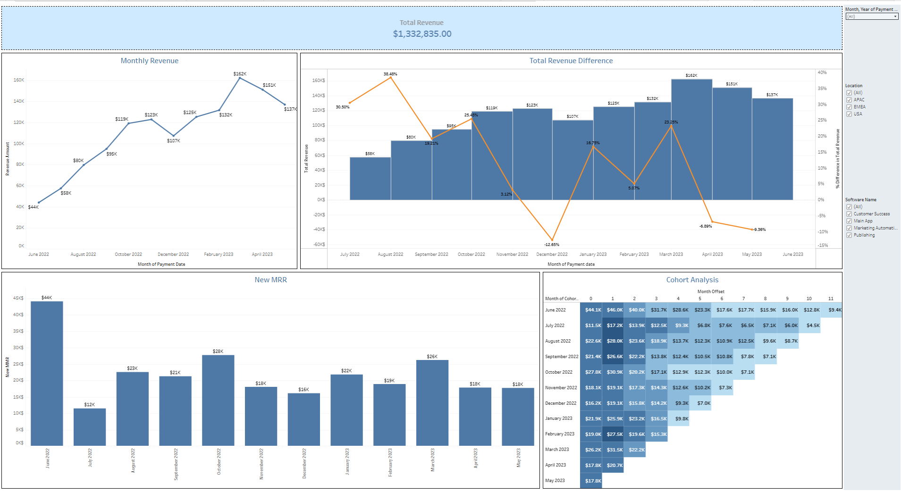
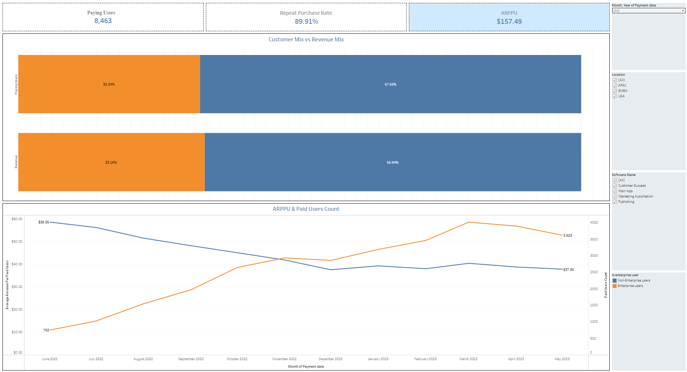
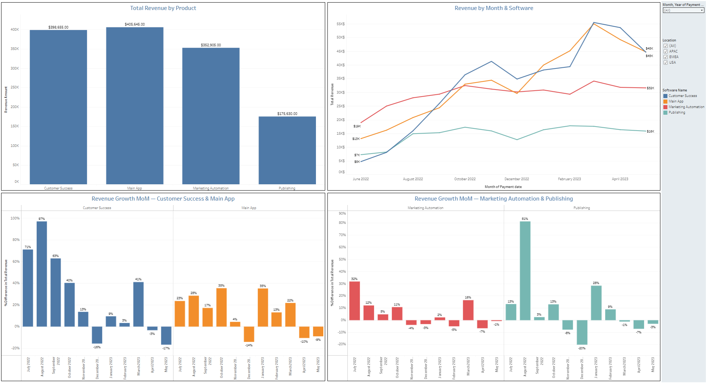
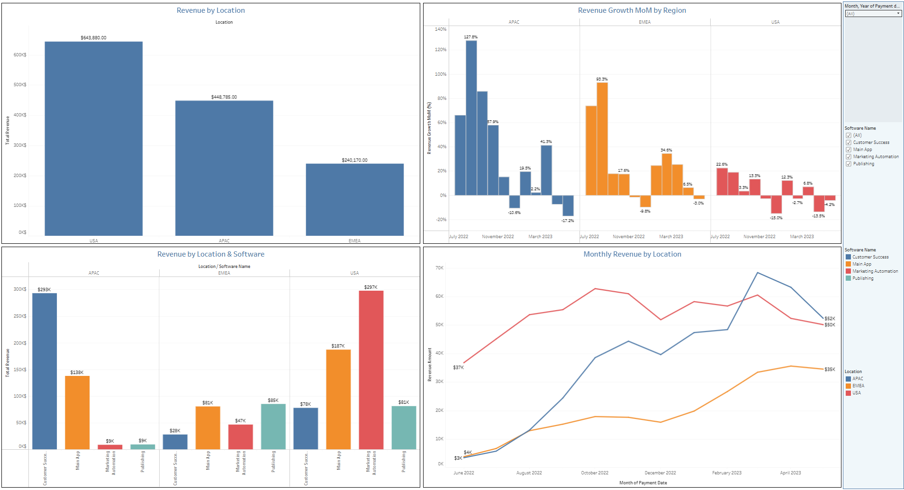

# SaaS Revenue & Product Analytics

An interactive Tableau analytics project exploring SaaS business performance through revenue trends, customer behavior, product performance, and geographic analysis.

🔗 **[Explore the Interactive Dashboard on Tableau Public](https://public.tableau.com/views/SaaSRevenueProductAnalytics/RevenueOverview)**

## Project Overview

The objective of this project was to design and develop a set of interactive Tableau dashboards to monitor key SaaS business metrics, identify revenue trends, and support data-driven decision-making.

The project consists of four dashboards, each focusing on a different area of business performance.

## Key Metrics

| Metric | Value |
|---|---|
| Total Revenue | $1,332,835 |
| Paying Users | 8,463 |
| Average Revenue per Paying User (ARPPU) | $157.49 |
| Repeat Purchase Rate | 89.91% |

## Dashboards

### 1. Revenue Overview

Analyzes overall revenue performance and changes over time.

**Key features:**
- Total Revenue KPI
- Monthly Revenue Trend
- Month-over-Month Revenue Change
- New Monthly Recurring Revenue (New MRR)
- Cohort Analysis

### 2. Customer Analytics

Explores customer activity, purchasing behavior, and revenue contribution.

**Key features:**
- Paying Users KPI
- Repeat Purchase Rate
- Average Revenue per Paying User (ARPPU)
- Customer Mix vs. Revenue Mix
- Monthly ARPPU and Paying Users Trends

### 3. Product Analytics

Evaluates the financial performance of individual SaaS products.

**Key features:**
- Total Revenue by Product
- Monthly Revenue by Software
- Month-over-Month Revenue Growth by Product
- Interactive Product Performance Comparisons

### 4. Location Analytics

Examines revenue distribution and growth across geographic regions.

**Key features:**
- Monthly Revenue by Location
- Revenue Growth MoM by Region
- Total Revenue by Location
- Revenue by Location and Software

## Key Insights

- Total revenue reached approximately **$1.33M** during the analyzed period
- The Main App and Customer Success products generated the highest total revenue
- The USA was the largest revenue-generating region, followed by APAC and EMEA
- Paying user activity increased over time, while monthly ARPPU showed a declining trend
- Product-level and regional analyses highlighted differences in revenue contribution and monthly growth

## Tools & Skills

- **Tableau:** Interactive dashboards, calculated fields, table calculations, filters, and data visualization
- **Data Analysis:** Revenue analysis, customer segmentation, product performance, and geographic analysis
- **Business Metrics:** Revenue, ARPPU, Paying Users, Repeat Purchase Rate, New MRR, and MoM Growth
- **Dashboard Design:** KPI reporting, trend analysis, comparative charts, and cohort visualization

## Project Files

The repository includes the Tableau workbook and dashboard screenshots.

For the full interactive experience, visit the Tableau Public link above.

## Author

**Olga Wyżewska**

Junior Data Analyst | BI Analyst

[GitHub Profile](https://github.com/Olvyz)
