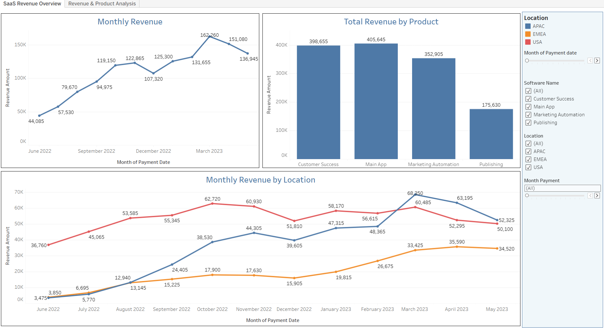
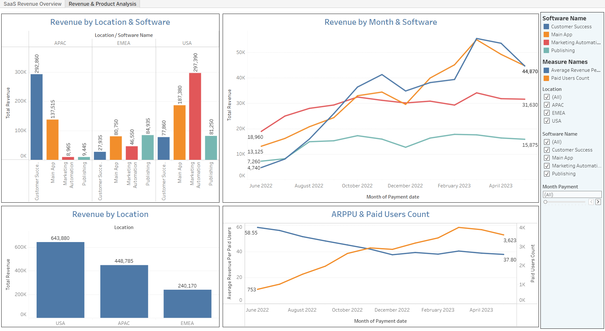

# saas-revenue-product-analytics
Tableau project analyzing SaaS revenue, paid users, ARPPU, product performance and geographic trends
# SaaS Revenue & Product Analytics

Tableau project focused on analyzing SaaS revenue, paid users, product performance and geographic trends

🔗 **[View Interactive Dashboard on Tableau Public](https://public.tableau.com/views/SaaSRevenueProductAnalytics/SaaSRevenueOverview?:language=en-US&publish=yes&:display_count=n&:origin=viz_share_link)**

## Project Goal

The goal of the project was to build an interactive Tableau dashboard that provides a clear overview of SaaS business performance and allows users to explore revenue across products, locations and time periods

The analysis focuses on:

* revenue performance and monthly trends;
* paid users and ARPPU;
* product performance;
* geographic revenue distribution;
* revenue comparison across products and locations

## Dashboards

### SaaS Revenue Overview

Provides an overview of key SaaS revenue metrics and trends

### Revenue & Product Analysis

Provides a more detailed view of revenue performance across products, locations and time periods

## Tools & Technologies

* Tableau
* Data Visualization
* Dashboard Design
* Data Analysis

## Analysis & Features

* monthly revenue analysis;
* revenue analysis by location;
* revenue analysis by product/software;
* paid users analysis;
* ARPPU analysis;
* comparison of product performance;
* interactive dashboard exploration

## Project Files

The Tableau `.twb` workbook is available in this repository

## Author

**Olga Wyżewska**
Data Analyst / BI Analyst
